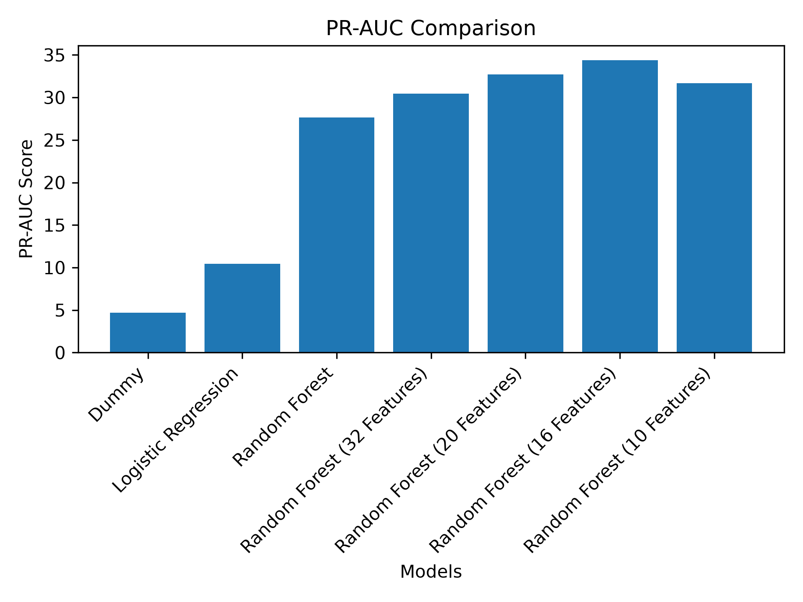

# LeanSignal Bankruptcy

## Project Question
How much bankruptcy-prediction performance can be retained with fewer financial-ratio features?
How much evaluation quality can we preserve while removing features?
Show evaluation metrics for the final result and how we can achieve modest if not best evaluation.

## Dataset
The dataset is composed of 10,503 rows of data, 64 columns of anonymous features, and 1 target class column for the bankrupt and non-bankrupt labeled as bytes '1' and '0' respectively
The dataset include missing features/values across 44 columns
The dataset is severely imbalanced for its class with 95.29% (10,008) non-bankrupt, and 4.71% (495) bankrupt entries
The dataset follows an 80/20 split strategy for labeled as development and testing splits. Then the development split is further split into an 80/20 training and evaluation split for the training and evaluation of the models while leaving the 20-testing split for final evaluation.
To address missing values within the dataset, we used SimpleImputer following the median strategy for each column. The imputer was fit using only the training split. No testing data split has been used for imputer and evaluation model trainings. This is to prevent the models from being optimistic and seeing values from the testing data.

## Evaluation Strategy
Due to the severe imbalance in class, rare positive class, and the goal of evaluating positive-class ranking/performance and prediction quality while avoiding false predictions, we will still report accuracy but not as a primary metric. In return, we will use PR-AUC as our primary metric in accordance with the dataset and goals, supported by the ROC_AUC, Precision, Recall, and F1.

## Models
Dummy (64 Features)
Logistic Regression (64 Features) 
Random Forest (64 Features)
Random Forest (32 Features)

## Feature Selection
Using SelectFromModel, a selector was trained using the training split, using a median threshold feature strategy. The first selector made from the Random Forest classifier effectively removed half of the features from 64 to 32.

## Validation Results
### Baseline Results
| Model                       | Features | PR-AUC | ROC-AUC | Precision | Recall | F1    | Accuracy |
|-----------------------------|----------|--------|---------|-----------|--------|-------|----------|
| Dummy                       | 64       | 4.7    | 50.0    | 0.0       | 0.0    | 0.0   | 95.3     |
| Logistic Regression         | 64       | 10.44  | 71.08   | 0.0       | 0.0    | 0.0   | 95.24    |
| Random Forest               | 64       | 27.65  | 83.25   | 62.5      | 6.33   | 11.49 | 95.42    |
| Random Forest (32 Features) | 32       | 30.47  | 83.71   | 77.78     | 8.86   | 15.91 | 95.6     |
### PR-AUC Comparison

## Current Interpretation
From the current table, accuracy can certainly be seen as uninformative and an unreliable metric due to the class imbalance. The three models dummy, logistic regression, and random forest acts as the baseline models and provide little to modest results respectively. The first feature selection results achieved higher PR-AUC results from the baseline random forest model even though 50% of the features were removed, --showing how model improvements can be achieved and possibly retained through feature selection--.

## Limitations
The dataset shows severe class imbalance and a rare positive-class
A single train/validation split was used rather than repeated evaluation
The models were untuned and used default thresholds when trained
Financial-ratio features are anonymous, limiting interpretability
Validation results are not final test results; The test data split would be used for the final test results
Note: This is an educational predictive experiment and not a financial decision support system

## Reproducing the Project
### Install dependencies:
python -m pip install -r requirements.txt

### Clone and run the project:
git clone https://github.com/Zieroed/leansignal-bankruptcy.git
python src/leansignal/main.py