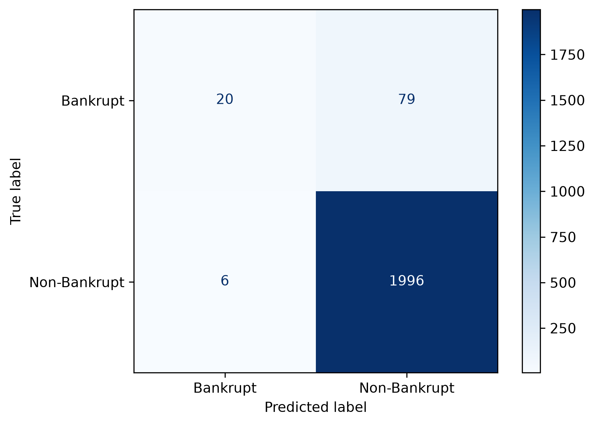

# LeanSignal: Bankruptcy Prediction with Fewer Financial Ratios

## Project Question
How much bankruptcy-prediction performance can be retained with fewer financial-ratio features?

## Dataset
UCI Polish Companies Bankruptcy, 3-year forecasting case
The dataset is composed of 10,503 rows of data, 64 columns of anonymous financial-ratio features, and 1 bankruptcy target class column for the bankrupt and non-bankrupt labeled as bytes '1' and '0' respectively. The ARFF dataset source stores the target column as byte labels, which are converted to integer 0 (non-bankrupt) and 1 (bankrupt) 
The dataset include missing features/values across 44 columns
The dataset is severely imbalanced for its class with 95.29% (10,008) non-bankrupt, and 4.71% (495) bankrupt entries
The dataset follows an 80/20 split strategy for labeled as development and testing splits. Then the development split is further split into an 80/20 training and evaluation split for the training and evaluation of the models while leaving the 20-testing split for final evaluation.
To address missing values within the dataset, we used SimpleImputer following the median strategy for each column. The imputer was fit using only the training split. No testing data split has been used for imputer and evaluation model trainings. This is to prevent the models from being optimistic and seeing values from the testing data.

## Evaluation Strategy
Due to the severe imbalance in class, misleading accuracy, rare positive class, and the goal of evaluating positive-class ranking/performance and prediction quality. Hence, we will use PR-AUC as our primary metric in accordance with the dataset and goals, supported by the ROC_AUC, Precision, Recall, and F1. Accuracy is still reported but not as a primary metric.

## Models
Dummy (64 Features)
Logistic Regression (64 Features) 
Random Forest (64 Features)
Random Forest (32 Features)
Random Forest (20 Features)
Random Forest (16 Features) / Final Model
Random Forest (10 Features)

## Feature Selection
Using SelectFromModel, a selector was trained using the training split with a -np.inf threshold and top-k features strategy. To further experiment prediction quality preservation with lower financial-ratio features, a top-k features strategy was implemented, choosing top 32, 20, 16, and 10 features. 32 was chosen to follow a median / half feature strategy, 20 and 16 were chosen to test aggressive feature reduction, and 10 was chosen as the minimum to test if results remain meaningful with a really compact feature set. These counts were pre-defined before examining evaluation results to avoid an optimistic result.
Feature reduction: 64 -> top 32 -> top 20 -> top 16 -> top 10

## Validation Results
### Baseline
| Model                 | Features | PR-AUC | ROC-AUC | Precision | Recall | F1    | Accuracy |
|-----------------------|----------|--------|---------|-----------|--------|-------|----------|
| Dummy                 | 64       | 4.7    | 50.0    | 0.0       | 0.0    | 0.0   | 95.3     |
| Logistic Regression   | 64       | 10.44  | 71.08   | 0.0       | 0.0    | 0.0   | 95.24    |
| Random Forest         | 64       | 27.65  | 83.25   | 62.5      | 6.33   | 11.49 | 95.42    |
### Feature Selection
| Random Forest         | 32       | 30.47  | 83.71   | 77.78     | 8.86   | 15.91 | 95.6     |
| Random Forest         | 20       | 32.7   | 81.93   | 92.31     | 15.19  | 26.09 | 95.95    |
| Random Forest         | 16       | 34.38  | 80.72   | 92.31     | 15.19  | 26.09 | 95.95    |
| Random Forest         | 10       | 31.66  | 80.96   | 86.67     | 16.46  | 27.66 | 95.95    |
### Final
| Final Random Forest   | 16       | 45.79  | 86.39   | 76.92     | 20.2   | 32.0  | 95.95    |
### PR-AUC Comparison

### Final Confusion Matrix

## Interpretations
### Baseline
From the current table, accuracy can certainly be seen as uninformative and an unreliable metric due to the class imbalance. The three models dummy, logistic regression, and random forest acts as the baseline models and provide little to modest results respectively. 
### Feature Selection
The first feature selection results achieved higher PR-AUC results from the baseline random forest model even though 50% of the features were removed. Results from the PR-AUC evaluation metric showed a decline from 34.38% to 31.66% when features were reduced to 10 indicating too much feature reduction could affect prediction quality as well. Within the training and evaluation splits, the model with the top 16 remaining features achieved the highest PR-AUC result, making it the model being chosen for the final model training.
### Final
The random forest model reduced the financial-ratio features from 64 to 16 through importance selection, resulting in a 75% feature reduction. The top 16 model achieved 34.38% on the validation split. After refitting the model on the whole developmental data, the final model achieved 45.79% PR-AUC on the test split. 

## Limitations
The dataset shows severe class imbalance and a rare positive-class
A single train/validation split was used rather than repeated evaluation
The models were untuned and used default thresholds when trained
Financial-ratio features are anonymous, limiting interpretability
Validation results are not final test results; The test data split was used for the final test results
Final results were accidentally evaluated in early development once using a 32-feature configuration, however, no analysis was done and the result did not affect later model / feature selection decisions
Note: This is an educational predictive experiment and not a financial decision support system

## Reproducing the Project
### Clone the project:
git clone https://github.com/Zieroed/leansignal-bankruptcy.git
### Go inside the directory:
cd leansignal-bankruptcy
### Install dependencies:
python -m pip install -r requirements.txt
### Run preprocessing test:
python -m pytest -q
### Run the project:
python src/leansignal/main.py